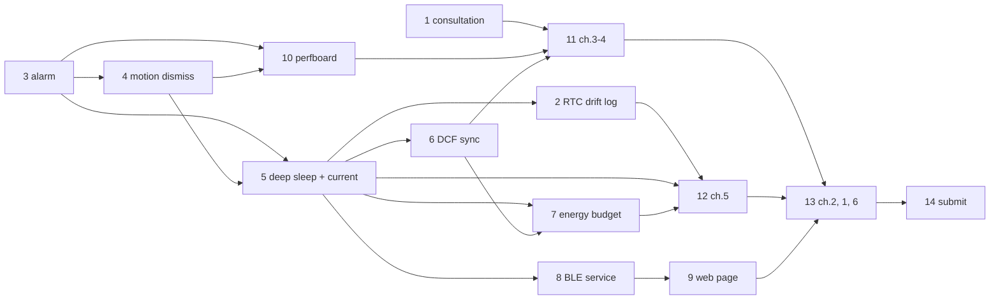

# Thesis roadmap

Source of truth for the order of work from 2026-10-17 to the faculty deadline. Created by the archived change `plan-thesis-roadmap` (process, skeleton, evidence log, deadlines). Every open stage below is its own OpenSpec change. Progress lives in each change's `tasks.md`; this file only holds order, dependencies and dates.

Rules that bind every stage (promotor, 2026-10-13, and author decisions): prototype first, prose last; chapters written in order 3, 4 → 5 → 2 → 1, 6; dated notes in `notes/` during bring-up; schematics are real schematics; agents draft, the author rewrites every kept paragraph and logs it in `notes/ai-use.md`; the AI-disclosure section is author-only; no volunteer tests. Hardware minimum is a soldered perfboard.

## Deadlines

| Milestone | Date | Status |
| --- | --- | --- |
| Full draft to promotor | 03.12.2026 | assumed |
| Last version to promotor | 07.12.2026 | assumed |
| Antiplagiarism upload | 10.12.2026 | assumed (same day as 10.12.2025) |

Replace these when the faculty publishes this year's harmonogram. See `notes/deadlines.md`.

## Already done (change `plan-thesis-roadmap`)

Evidence log and backfill, AI-use log, thesis skeleton (six chapters, empty AI-disclosure heading), APD title check, seeded bibliography, hardware block diagram, print-safe breadboard schematic, software flowchart drawing (`firmware/docs/software-flowchart.*`), perfboard decision. Firmware tip when this roadmap was written: bare-metal clock app on the DK (`firmware/apps/clock`), polling loop, no deep sleep yet.

## Stages

Order follows `design.md` decision 3 of the archived change: sleep numbers drive chapter 5, so they land before BLE.

| # | Change | Roadmap source | Needs | Verify (short) |
| --- | --- | --- | --- | --- |
| 1 | `prepare-first-consultation` | 3.2, 6.1 | none | promotor saw prototype, block diagram, flowchart; feedback noted |
| 2 | `add-rtc-clock-drift-log` | 4.1 | 5 (runs on the deep-sleep build) | photo + 24 h drift CSV |
| 3 | `add-alarm-schedule-and-buzzer` | 4.2 | none | alarm fires at set HH:MM, any DK button silences |
| 4 | `add-motion-dismiss` | 4.3 | 3 | MCU wakes on INT1 only on motion; N activity count silences |
| 5 | `add-deep-sleep-and-current-measurement` | 4.4 | 3, 4 | CSV of sleep, e-paper refresh, DCF window, alarm currents |
| 6 | `add-dcf77-periodic-sync` | 4.5 | 5 | Nucleo generator drives a sync, PON off after |
| 7 | `add-energy-budget` | 4.6 | 5, 6 | `hardware/docs/energy-budget.md` table, calculation vs measured |
| 8 | `add-ble-alarm-schedule-service` | 4.7 | 5 | nRF Connect writes a schedule, firmware echoes it |
| 9 | `add-web-bluetooth-schedule-page` | 4.8 | 8 | browser upload changes alarm time on DK |
| 10 | `build-perfboard-prototype` | 5.1 | 3, 4 hardware frozen | ERC-clean KiCad schematic, soldered board |
| 11 | `draft-thesis-chapters-3-4` | 6.2 | 10 hardware frozen, 3–6 | rewritten LaTeX, every figure referenced, drafts in `ai-use.md` |
| 12 | `draft-thesis-chapter-5` | 6.3 | 5, 6, 7 | tables/charts cite CSV files |
| 13 | `draft-thesis-chapters-2-1-6` | 6.4 | 11, 12 | ≥12 sources, all cited, author checked each |
| 14 | `submit-thesis` | 6.5, 6.6 | 13 | author wrote the AI-disclosure; dates match `notes/deadlines.md` |

## Proposed schedule

Targets, not faculty dates. Adjust at each consultation. Chapter 3 may start once stage 10 freezes the hardware blocks.

| Week of | Work |
| --- | --- |
| 19.10 | 1; 3 starts (photo of upright clock taken now) |
| 26.10 | 3, 4 |
| 02.11 | 5; 10 starts in parallel; 24 h drift (2) runs while the author is at work |
| 09.11 | 6, 7; draft ch.3 |
| 16.11 | 8, 10 done; draft ch.4 |
| 23.11 | 9; draft ch.5, then ch.2, 1, 6 |
| 30.11 | author rewrite pass, 03.12 full draft to promotor |
| 07.12 | last version to promotor (07.12), faculty upload (10.12) |

Cut line if time runs out: stages 8 and 9 (BLE and web) drop first. They are configuration only, and the thesis title keeps "wireless configuration", so dropping them needs a promotor decision.

## Maintaining this file

- Starting a stage: `openspec status --change <name>`, then `/opsx-continue <name>` until planning is complete, then `/opsx-apply <name>`.
- Finishing a stage: archive its change, then tick the row's date in `notes/` log and, if the order moved, edit the table here in its own `thesis:`-free commit (`docs:`).
- New work that is not a thesis stage does not go in this file.
